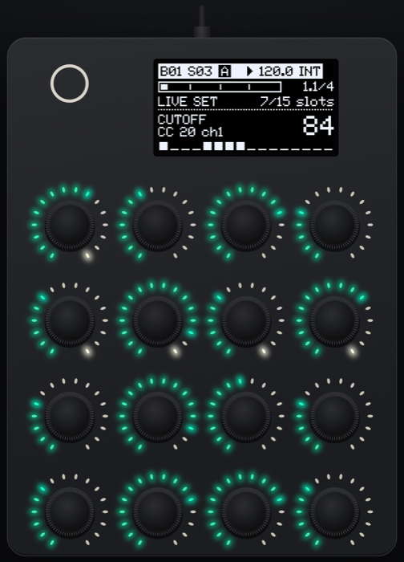
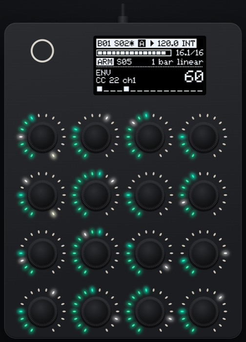
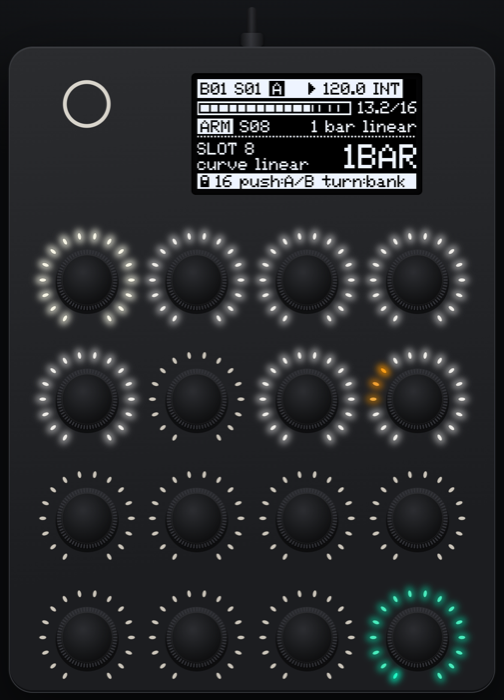
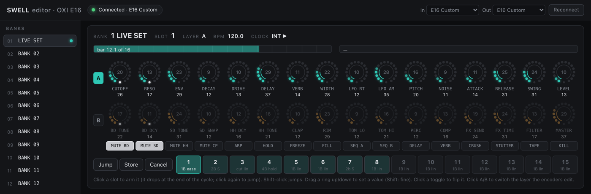
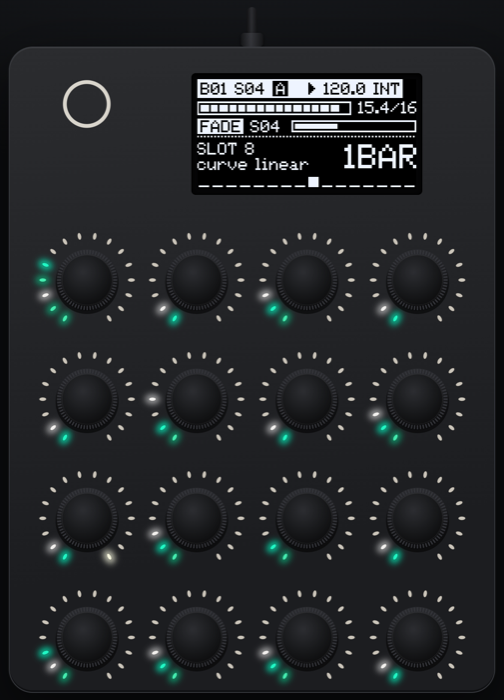
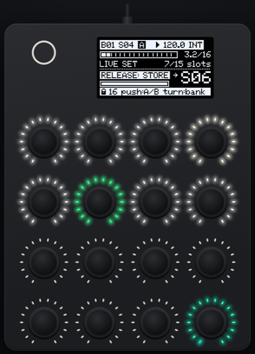
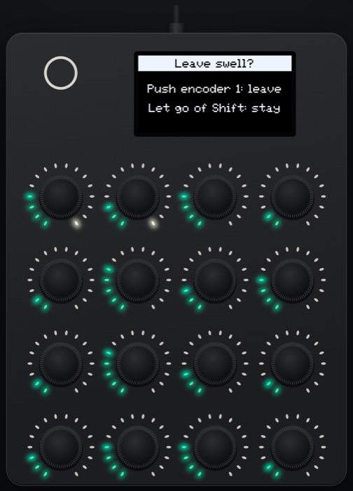

# Swell

**A snapshot-morphing performance controller for the OXI E16.**

Store the state of every knob in a snapshot. Then move to another one, either
now (a *jump*) or right on the next cycle boundary (a *drop*), with a fade
whose length and curve you choose. Grab a knob mid-fade and it's yours: that
control leaves the fade and the rest carry on.

Swell is a native app for the [E16 Launcher](https://github.com/charlesvestal/e16-sdk-examples)
firmware. A web editor sets up the mapping and shows everything live.

<p align="center">
  
  
  
</p>

<p align="center"><em>Playing · a slot armed, with each value's target shown as a white dot · Shift: the slots</em></p>

## What it does

- **32 controls and 16 toggles:** the 16 encoders on 2 layers, plus the encoder pushes.
- **15 snapshots per bank, 16 banks:** each bank has its own mapping, slots, tempo and cycle.
- **Drops and jumps:**
  - **Drops** land on the cycle boundary, every 1, 2, 4, 8 or 16 bars.
  - **Jumps** happen now, or on the next beat or bar.
  - **Fade lengths:** cut, 1 or 2 beats, or 1, 2, 4 or 8 bars.
  - **Curves:** linear, ease, S, or hold-then-cut.
- **Hands-on override:** turn a knob during a fade and it drops out of the fade.
- **Outputs:**
  - **Message types:** CC (7 or 14 bit) or NRPN (7 or 14 bit), with any range, inverted if you like.
  - **Ports:** any of TRS 1, TRS 2 and USB.
  - **Fades never pile up:** a fade sends the latest value, never a queue of stale ones.
- **Clock:**
  - It follows MIDI clock from USB or TRS (Start, Stop, Continue, Song Position).
  - With no clock coming in, it falls back to an internal tempo without losing its place.
  - It can send its own clock out.
- **The editor:** one HTML file, using Web MIDI over USB.
  - **Live view:** the 32 rings with their targets, the cycle countdown, and click-to-arm.
  - **Setup:** a table for every control, toggle and slot.

<p align="center">
  
</p>

## Get it running

You need an E16 running the E16 Launcher at
[`71f2c88`](https://github.com/charlesvestal/e16-sdk-examples/commit/71f2c88) or later, which has the leave prompt.

1. **Build** (needs `arm-none-eabi-gcc`, CMake and Python 3):

   ```sh
   git clone --recursive https://github.com/charlesvestal/e16-swell.git
   cd e16-swell
   make              # build/swell.e16app
   ```

2. **Install:** on the E16, pick *Disk mode* from the launcher menu, copy
   `build/swell.e16app` to `/apps/` on the drive that appears, and eject.
3. **Play:** start **swell** from the menu.

Out of the box every bank sends CC 20–35 (layer A) and CC 40–55 (layer B) on
channel 1 to TRS 1 and USB, and the toggles send CC 80–95. Open
[`editor/index.html`](editor/index.html) in Chrome or Edge to change any of it.

## The controls

| | |
|---|---|
| **Turn** | changes that control (on the current layer) |
| **Push + turn** | fine steps |
| **Push** | flips that encoder's toggle |
| **Shift held** (or tapped, to latch) | the encoders become the slots |
| Shift + **push** 1–15 | **arm** that slot to drop at the end of the cycle; push again to **jump** now |
| Shift + **hold** 1–15, release | **store** the current state into that slot |
| Shift + **turn** 1–15 | that slot's fade length (push + turn: its curve) |
| Shift + push / turn 16 | layer A/B / bank |
| Shift held on its own for 5 s | the launcher's prompt to leave (encoder 1 leaves, Swell saves first) |

<p align="center">
  
  
  
</p>

<p align="center"><em>A fade in progress · storing a slot · leaving</em></p>

The [manual](docs/manual.md) covers everything: the screen, the rings, the
editor, saving, and the limits.

## Repository

| | |
|---|---|
| `src/core/` | the engine: portable C, no hardware, no allocation. The headers are the spec, including the bank file format (`store.h`) and the editor protocol (`proto.h`) |
| `src/app.c`, `src/ui.c` | the E16 front end: the controls, rings, OLED and files |
| `editor/index.html` | the web editor (single file, no dependencies) |
| `test/` | host tests for the engine and protocol, and a check of the editor's JavaScript codec against the C one |
| `docs/` | the [manual](docs/manual.md), the [design](docs/design.md), screenshots |
| `external/e16-sdk-examples` | the E16 Launcher (submodule): the app SDK, toolchain file and font |

```sh
make test     # host tests (a C compiler; Node for the editor's)
```

The screenshots come from the launcher's web mirror
(`external/e16-sdk-examples/tools/mirror`) and the editor, both connected to
a real E16, captured with `tools/screenshot.mjs`.

## Credits

Written by Charles Vestal with [Claude Code](https://claude.com/claude-code).
It's based on OXI Instruments' [E16 SDK](https://github.com/OXI-Instruments/E16-SDK).
Swell isn't affiliated with OXI Instruments or Neuzeit Instruments.

MIT licensed, see [LICENSE](LICENSE).
