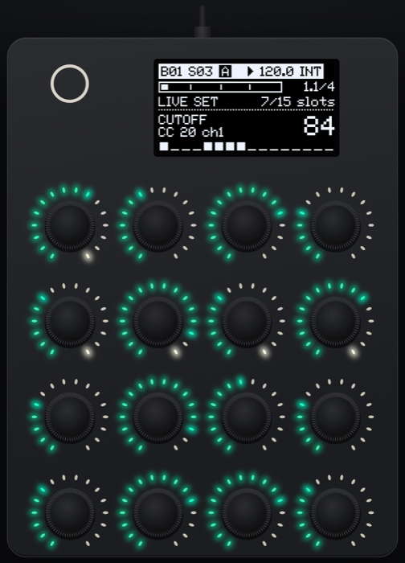
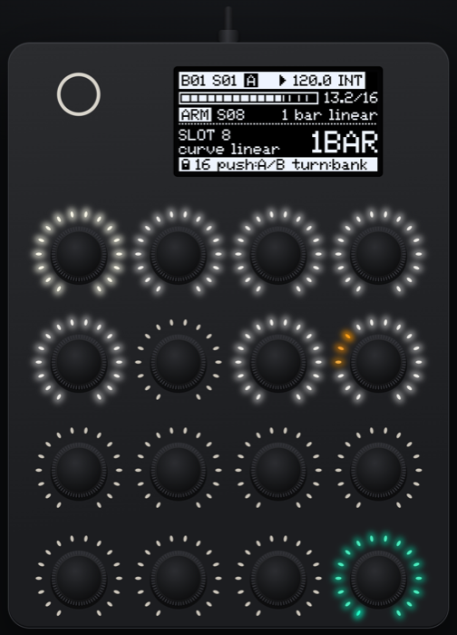
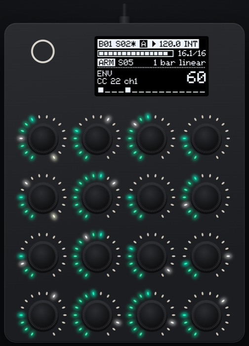
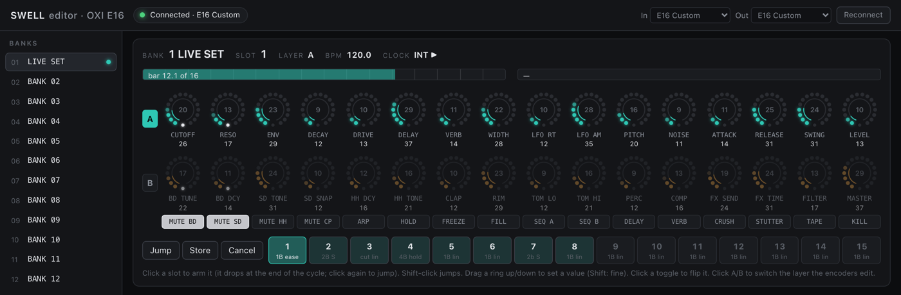
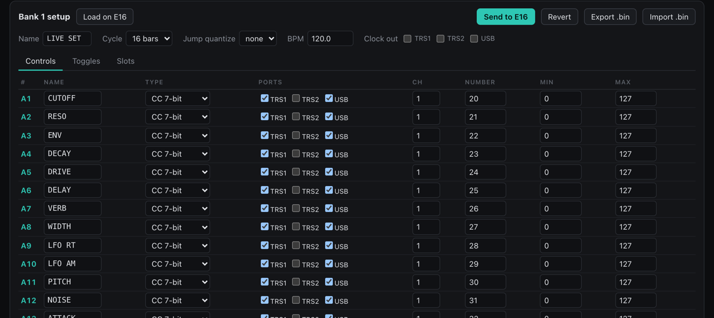

# Swell manual

Swell turns the OXI E16 into a MIDI performance controller. You store the
state of every control in a snapshot, then move to another snapshot,
either now (a *jump*) or at the end of the musical cycle (a *drop*), with
a fade of your choice. It runs as a native app on the
[E16 Launcher](https://github.com/charlesvestal/e16-sdk-examples).

- **Controls:** 16 encoders × 2 layers give 32 continuous controls, and
  the 16 encoder pushes are toggles.
- **Snapshots:** each bank has 15 snapshot slots, and there are 16 banks.
  Every bank has its own mapping (what each control sends), its own
  slots and its own tempo and cycle settings.
- **Outputs:** each control sends CC (7 or 14 bit) or NRPN (7 or 14 bit)
  on TRS 1, TRS 2 and/or USB. Fades are rate-limited per port, so a busy
  TRS output skips in-between values rather than falling behind.
- **Clock:** follows MIDI clock from USB or TRS in (Start, Stop,
  Continue and Song Position included). When no clock arrives, an
  internal tempo takes over without a jump in phase. The internal clock
  can be sent out.
- **Editor:** a web page sets everything up over USB and shows a live
  view.

## Install

You need the E16 Launcher at
[`71f2c88`](https://github.com/charlesvestal/e16-sdk-examples/commit/71f2c88)
or later on the E16 (see its README for flashing). Then:

```sh
git clone --recursive https://github.com/charlesvestal/e16-swell.git
cd e16-swell
make                      # build/swell.e16app
```

1. On the E16, pick **Disk mode** from the launcher menu. The E16 shows
   up as a drive.
2. Copy `build/swell.e16app` to `/apps/`. Optionally also copy
   `editor/index.html` to `/apps/swell/`, so the editor travels with the
   device.
3. Eject, then start **swell** from the menu.

On first start every bank is the factory default. Layer A sends CC 20-35
and layer B sends CC 40-55, all on channel 1 to TRS 1 and USB. The
toggles send CC 80-95. Every slot starts empty.

**A first session:** set a few knobs, hold Shift and hold encoder 1
until the OLED says `RELEASE: STORE`, then let go: that's slot 1.
Change the knobs, store slot 2 the same way. Now, with Shift held, push
encoder 1 once: it's armed, and at the end of the cycle (watch the bar
on the OLED) the knobs glide back to slot 1. Push an armed slot a second
time to go now instead.

## Controls

<p align="center"></p>

### Play mode (Shift up)

| Action | Result |
|---|---|
| Turn encoder *n* | Changes control *n* of the current layer. If a fade is running, that control leaves the fade and stays where you put it. |
| Push and turn | Fine steps. The push then doesn't toggle. |
| Push and release, with no turn | Flips toggle *n*. |

Each ring shows its control's value as an arc from 7 o'clock, in the
layer's colour (A is teal, B is amber). The brightest LED is the value.
A dim white dot marks where the value is heading when a drop or fade is
coming. The LED next to the gap at the bottom lights white while the
toggle is on.

### Shift mode: the slots

<p align="center"></p>

You get Shift mode by holding Shift, or by **tapping** Shift (pressing
and releasing it quickly without touching anything else), which latches
it. Tap Shift again to go back to play mode.

Holding Shift is fine for as long as you like (only Shift held *on its own* for 5 s brings up the launcher's leave prompt). The latch is there for
when you want both hands free for the slots.

| Action | Result |
|---|---|
| Push and release encoder 1-15 (under 0.6 s) | **Arms** that slot. It fades in at the next cycle boundary (a *drop*). Pushing the armed slot again **jumps** to it now, or at the next beat or bar if the bank quantizes jumps. Empty slots do nothing. |
| Hold encoder 1-15 for 0.6 s, then release | **Stores** the live values and toggles into that slot. The ring and the OLED fill up while you hold; once full, the OLED says `RELEASE: STORE`, and the store happens when you let go. Turning the encoder before you let go cancels the store (it's a curve edit instead). |
| Turn encoder 1-15 | Changes that slot's fade length: cut, 1 beat, 2 beats, 1 bar, 2 bars, 4 bars or 8 bars. |
| Push and turn encoder 1-15 | Changes that slot's curve: linear, ease, S-curve or hold. With hold, the values stay put until the end of the fade and then cut. |
| Push and release encoder 16 | Switches between layers A and B. A turn while it's pushed is ignored, so a click that comes with the push can't change the bank. |
| Turn encoder 16 | Changes the bank. The new bank jumps to its slot 1 if that slot is stored. |
| Hold Shift on its own for 5 s | The launcher's leave prompt: push encoder 1 to leave (Swell saves first), or let go of Shift to stay. |

The rings in Shift mode show each slot's state:
- Empty slots are dark.
- Stored slots are a dim full ring.
- The current slot is bright, and it pulses once you've changed something
  by hand since recalling or storing it.
- The armed slot has an amber segment that spins once a beat, or twice
  a beat for a pending jump.
- The slot being faded to fills clockwise in green as the fade
  progresses.

Ring 16 shows the layer and the bank: a dim ring in the layer's colour,
with one bright LED at the bank's position (bank 1 at 7 o'clock).

### Setting up on the E16

Everything the editor sets, you can also set on the E16, on two
settings pages. Each is a 4×4 grid laid out like the encoders, one
setting per encoder. The OLED shows half of it at a time: encoders 1–8
(the control), or 9–16 (its toggle). On the knob page, push one of the
blank knobs (8, 12 or 16, marked `PUSH ↓ 9-16` or `PUSH ↑ 1-8`) to see
the other half without changing anything; turning a knob in the other
half switches too. A bar at the right edge shows which half you're
looking at.

**Hold a push for 1 s without turning:**

| Hold | Opens |
|---|---|
| Encoder *n*, in play mode | the **knob page** for control *n* on the current layer, and toggle *n* |
| Encoder 16, in Shift mode | the **bank page** |

The ring fills white while you hold. Turning during the hold cancels it,
and a short push still flips the toggle.

**The knob page:**

| | | | |
|---|---|---|---|
| **TYPE** off, CC7, CC14, NRPN7 (`NRP7`), NRPN14 (`NR14`) | **CH** channel | **NUM** CC or NRPN number | **PORT** where it goes: `1` TRS 1, `2` TRS 2, `U` USB |
| **MIN** | **MAX** (below MIN inverts it) | **NAME** push to edit | |
| **TCC** the toggle's CC | **TCH** its channel | **TPRT** its ports (`off`: it sends nothing) | |
| **TOFF** the value sent for off | **TON** for on | **TNAM** push to edit | |

**The bank page:**

| | | | |
|---|---|---|---|
| **CYCL** cycle length, 1–16 bars | **JMPQ** when a jump lands: now, next beat, next bar | **BPM** the internal tempo | **CLK** where the clock goes out |
| **ALCH** the channel of every control and toggle | **ALPT** the ports of everything that sends | **NAME** push to edit | |

ALCH and ALPT show `mix` when the bank differs; the first turn makes
them all the same.

- **Turn** an encoder to change its field. **Push and turn** for big
  steps (128 on a 14-bit range, 10 on a 0–127 one); on BPM, push and
  turn goes in 0.1 instead of whole BPM.
- The **header** shows the page (`A3 CUTOFF  T3`), or the field you just
  turned in full (`channel 2`), and that cell lights up.
- The **rings** show where each field sits in its range.
- **Names:** push a NAME cell. Encoders 1–8 are then the 8 characters,
  each turning through space, A–Z, 0–9, a few signs and a–z.
- **Back:** push any other encoder (not a blank one on the knob page),
  or tap Shift: from the name editor to the page, from the page to
  playing.

The music keeps going while you're on a page: the clock, drops and
fades carry on. Changes save like any other (the dot in the header),
and the editor picks them up on its own.

### The OLED

<p align="center"></p>

1. **Header bar:** the bank (`B03`), the current slot (`S07`, with `*`
   when it has been modified), the layer, play or stop, the tempo, and
   the clock source (`INT` or `EXT`). The dot to the right of the bar
   means the bank has unsaved changes.
2. **The cycle:** a progress bar for the cycle, with a tick at each bar,
   plus the position as `bar.beat/bars`. A drop happens when the bar
   fills.
3. **What's coming:** `ARM`, `JUMP` or `FADE` with the slot. For ARM and
   JUMP it shows the slot's fade and curve; for FADE, a progress bar.
   With nothing pending, this line shows the bank's name and how many of
   its slots are stored.
4. **The last thing you touched:** its name, what it sends (`CC 20 ch1`),
   and its value in output units in large type. For a slot, it shows its
   fade and curve instead. While you're holding a slot to store it, this
   area shows `STORE → S07` with a filling bar, then `RELEASE: STORE`
   once letting go will store it.
5. **Bottom row:** in play mode, the 16 toggles (a block for on, a line
   for off). In Shift mode, a legend for encoder 16. A lock icon there
   means Shift is latched.

## The editor

<p align="center"></p>
<p align="center"></p>

Open `editor/index.html` in Chrome or Edge, since it needs
Web MIDI with SysEx. It connects to the MIDI port whose name contains
"E16" and reads all 16 banks.

- **Setup:** for each control you set the name, the type (off, CC7,
  CC14, NRPN7 or NRPN14), the ports, the channel, the number and
  min/max. You can set max below min to invert a control. For each
  toggle you set the name, ports, channel, CC and its off/on values. You
  can also set each slot's fade and curve, and the bank's name, cycle
  length (1, 2, 4, 8 or 16 bars), jump quantize (none, beat or bar),
  tempo and clock output. "Send" writes the bank to the E16, which
  saves it.
- **Live view:** shows the 32 rings with their targets, the countdown,
  the armed and fading slots, and the clock. You can click a slot to arm
  it (again to jump), store a slot, and drag a ring to set its value.
- **Files:** you can export a bank as a `.bin` file and import one. The
  file has the same format as the files on the device.

The protocol is SysEx over USB only, documented in
[`src/core/proto.h`](../src/core/proto.h).

## Files

| File | What it holds |
|---|---|
| `/apps/swell/bank00.bin` … `bank15.bin` | One bank each: 1870 bytes, CRC-checked. The format is in [`src/core/store.h`](../src/core/store.h). |
| `/apps/swell/state.bin` | The current bank and layer. |

A bank gets saved after you store a slot, edit a slot's fade or curve,
or send it from the editor. To spare the flash, Swell waits until
nothing has changed for 2 s, and writes any one file at most every
15 s. If the flash is busy, it tries again a second later. The dot in
the header stays on until the bank is written.

At start, a missing bank file gives the factory default. A file that is
damaged (wrong size or a bad CRC) is never used: Swell uses the default
instead and logs it. Leaving from the launcher's prompt (hold
Shift on its own for 5 s, push encoder 1) saves what's unsaved first.
The flash's erase budget can still refuse a save just after another one;
that's logged.

## Limits

- 4/4 only: a bar is 4 beats.
- One SysEx request at a time, on USB only.
- When TRS 2 carries the synth's audio, it sends no MIDI, so controls
  mapped to it go nowhere.
- At start, if slot 1 of the current bank is stored, Swell recalls it and
  sends every control and toggle once. If it isn't, nothing is sent until
  you touch something, so an empty bank never zeroes your rig.
- There's no chaining of snapshots and no MIDI merge (input isn't
  passed through). Chaining is planned for v1.1.
- A save to the flash holds everything up for about 20 ms, so one
  clock-out pulse comes that much late.
- **Memory:** all 16 banks stay in RAM (about 29 KB). The app has about
  22 KB of code and 40 KB of data, well inside the app limits.

## Tests

`make test` runs the host tests in `test/`: the engine (clock following,
drops, jumps, every fade curve, override), the settings pages' fields, the bank file format, the
MIDI output (exact CC14/NRPN bytes, the rate limit), the editor protocol,
and the editor's JavaScript codec against the C one. The front end
(`src/app.c`, `src/ui.c`) is checked on the device.
